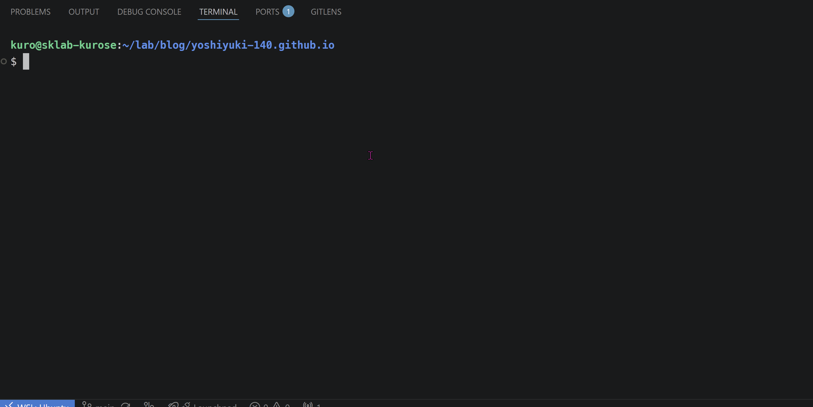

# llslug (local-llm-slug)

`llslug` は，ローカルLLMを活用して，日本語の記事タイトルからURLフレンドリーな英語のケバブケース（Slug）を自動生成する，Hugo専用のCLI拡張です．
`hugo-llslug` として実行できます．

## 前提

1. [Ollama](https://github.com/ollama/ollama) がローカルマシンにインストールされ，起動していること．
2. [hugo](https://github.com/gohugoio/hugo)がインストールされていること．
3. 使用する軽量LLMモデル（推奨: `liquidai/lfm2.5-350m:q4_0` など）がダウンロードされていること．

```bash
# 推奨モデルのダウンロード
ollama pull liquidai/lfm2.5-350m:q4_0
```

## インストール

### Linux / macOS

```bash
curl -fsSL https://raw.githubusercontent.com/yoshiyuki-140/hugo-llslug/main/install.sh | sh
```

### Windows (PowerShell)
環境のアーキテクチャ（デフォルトは `x86_64`）に合わせて実行してください．

```powershell
# x86_64 (標準)
powershell -Command "Invoke-WebRequest -Uri https://raw.githubusercontent.com/yoshiyuki-140/hugo-llslug/main/install.ps1 -OutFile install.ps1; .\install.ps1"

# arm64 / i386 を指定する場合（-Arch オプションを追加）
# .\install.ps1 -Arch arm64
```

## 使い方



Hugoプロジェクトのルートディレクトリで実行します．

```bash
$ hugo-llslug
Please select or enter the section name for the new article.

  class
> posts
  Enter a new section name

↑/↓: move • enter: select • q: quit
Please enter the title of the article.

> タイトルからHugoのSlugを自動生成してくれるCLIツールを作ってみた! 

enter: confirm • esc: quit
Generating ...
Select a slug for the new article.

> hugo-automated
  titled-hugo-generator
  cli-hugo-tutorial
  gen-hugo-slugs
  automated-hugo
  🔄 Regenerate candidates
  Enter a custom slug

↑/↓: move • enter: select • q: quit
Executing Hugo Command ...
`hugo new posts/hugo-automated/index.md`
Completed !
```
